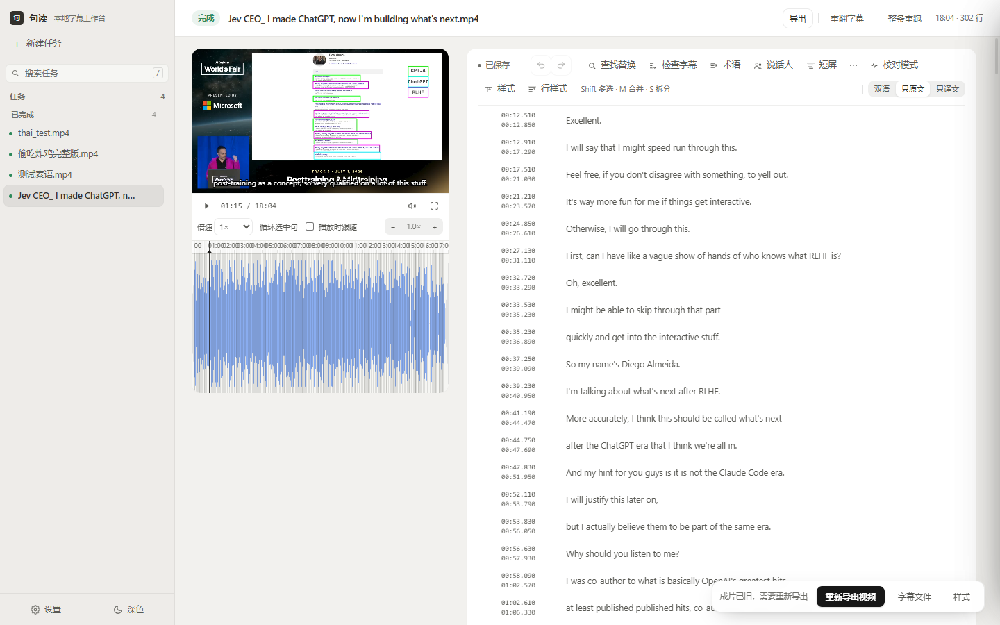
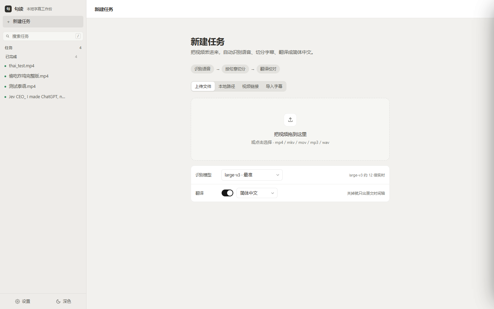
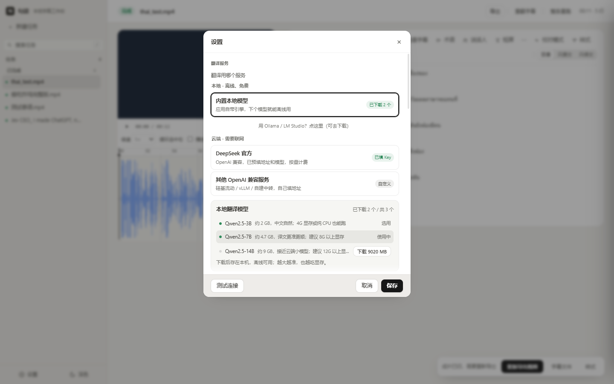
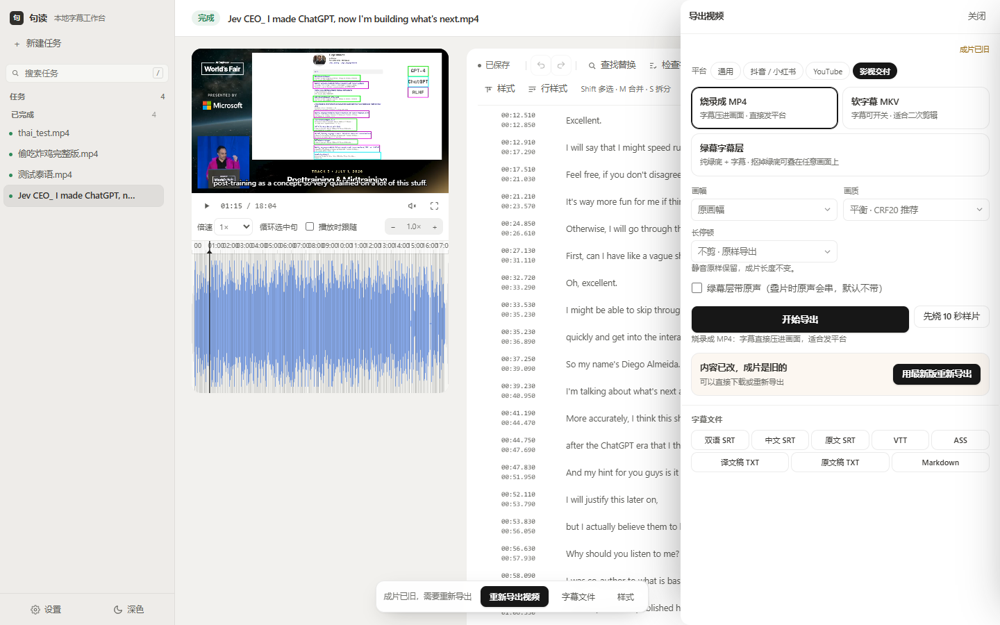

<div align="center">

# Judou · Local Subtitle Workbench

**Video in, finished cut out — transcribe, segment, translate, review and export on one machine**

[简体中文](README.md) · [English](README.en.md)

[](https://github.com/justtio/judou-releases/releases/latest)
[](https://github.com/justtio/judou-releases/releases)
[](#requirements)
[](#why-this-exists)

[Download](#download) · [Features](#features) · [FAQ](#faq) · [Changelog](CHANGELOG.md)

</div>



---

## Why this exists

Plenty of tools will auto-generate subtitles. This one is built around what happens **after** that:

| | |
|---|---|
| **Your video never leaves the machine** | Transcription and translation both run locally. Interviews, internal meetings, unreleased footage — nothing is uploaded. |
| **Review is a first-class step** | Waveform editing, QC panel, per-line style, inline emphasis, glossary consistency. Not an afterthought. |
| **Translation stays line-aligned** | Line correspondence is enforced. When a small model drops a line, it is detected and re-translated instead of silently left blank. |

## Features

### Transcription

- faster-whisper: `large-v3` / `large-v3-turbo` / `medium` / `small`
- CUDA acceleration on NVIDIA GPUs, **CPU-only works too**
- Import existing subtitles (SRT / VTT / ASS) and skip straight to translation and review



### Segmentation & timeline

- Splits by **sentence meaning**, not a fixed character count
- Waveform: zoom, drag to retime, ripple shifts
- **Dragging a subtitle never moves the playhead** — editing gestures and playback gestures are separate
- Per-line nudging, batch shift, shortcuts (`M` merge, `S` split, `Shift` multi-select)

### Translation

- **Cloud**: DeepSeek, or any OpenAI-compatible endpoint (vLLM, OneAPI, SiliconFlow…)
- **Local**: bundled llama.cpp + Qwen2.5 (3B / 7B / 14B) — one click to download, then fully offline and free
- Glossary plus a second proofreading pass for consistent terminology
- Targets: Simplified Chinese · Traditional Chinese · English · Japanese · Korean · Thai



### Review

- QC panel separates two severities:
  - **Structural errors** (empty line, missing translation, inverted or overlapping times)
  - **Hints** (reading speed, line length, duplicates, punctuation)
- Lines you edited manually stop being flagged — no nagging about decisions you already made
- Per-line style: free position, size, colour, weight
- Inline emphasis: recolour just a few characters inside a line

### Export

- **Burned-in MP4** — subtitles rendered into the frame, ready to publish
- **Soft-sub MKV** — toggleable subtitles for further editing
- **Green-screen layer** — chroma-friendly subtitle overlay
- Presets: general · TikTok/Xiaohongshu · YouTube · cinema delivery
- Subtitle files: bilingual SRT, Chinese SRT, source SRT, VTT, ASS, plain text



---

## Download

**[⬇ Get the latest version](https://github.com/justtio/judou-releases/releases/latest)**

The installer is about 1 GB — it bundles the Python runtime, ffmpeg and CUDA libraries. Speech models are downloaded on first use.

> **Windows says "Windows protected your PC"?**
> The installer is not code-signed (a certificate costs thousands per year). Click **More info → Run anyway**; functionality is unaffected.

### Quick start

1. Install and launch. The first run asks which speech model to use — `large-v3-turbo` is a good default.
2. Drop a video into **New task** and wait for it to finish.
3. Review in the editor, then hit **Export** in the top right.

### Requirements

| | |
|---|---|
| OS | Windows 10 / 11, 64-bit |
| GPU | Optional. An NVIDIA GPU is 3–5× faster via CUDA; CPU-only is supported |
| Disk | ~2.3 GB installed, plus models (small ≈ 0.5 GB, large-v3 ≈ 3 GB) |
| RAM | 16 GB recommended |
| Network | Only needed to download models or when using cloud translation |

### Updates

About 12 seconds after launch the app checks for updates and asks before downloading.
Updates are **differential**: only changed blocks are fetched, usually 1–3 MB, done in seconds.

You can also install a newer version from [Releases](https://github.com/justtio/judou-releases/releases) over the existing one — projects and settings are preserved.

---

## FAQ

<details>
<summary><b>Which translation service should I pick?</b></summary>

- Online and want quality → **DeepSeek** (needs an API key, pay per use, very cheap)
- Offline and free → **Built-in local model** (3B ≈ 2 GB or 7B ≈ 4.7 GB download)
- **Ollama / LM Studio** are separate apps — pick them only if you already run them; otherwise the card links you to the download

Unsure? Press **Test connection** — it actually translates three lines and verifies the line count.
</details>

<details>
<summary><b>Do small local models drop lines?</b></summary>

Occasionally, yes — a JSON-mode response can come back one line short.
The app detects missing lines and re-translates them individually with a plain-text prompt.
If output is consistently misaligned, switching to a stronger instruction-following model helps more than tweaking parameters.
</details>

<details>
<summary><b>Why is the first transcription slow?</b></summary>

The speech model is downloaded on first use (`large-v3` ≈ 3 GB). After that, startup only needs a few seconds to load it.
</details>

<details>
<summary><b>Can I batch multiple videos?</b></summary>

Yes. Tasks are processed sequentially in a queue, so they don't fight over VRAM.
</details>

<details>
<summary><b>Where is my data? Will uninstalling delete it?</b></summary>

Projects, settings and models stay on your machine:

```
%LOCALAPPDATA%\字幕工作台\
```

Uninstalling does not remove this folder, so projects survive a reinstall.
</details>

<details>
<summary><b>macOS / Linux support?</b></summary>

Windows only for now. The stack is Python + Electron so porting is feasible, but it is not scheduled.
</details>

---

## Feedback

- Bugs and suggestions → [Issues](https://github.com/justtio/judou-releases/issues)
- Feature requests → same place; describing the workflow you need is enough

Two things make reports much faster to act on: the **version number** (bottom of Settings)
and the **backend log** at `%LOCALAPPDATA%\字幕工作台\backend.log`.

---

## About this repository

This repository holds **installers and documentation only** — no source code.
Installers live as attachments under [Releases](https://github.com/justtio/judou-releases/releases), not in git history.
