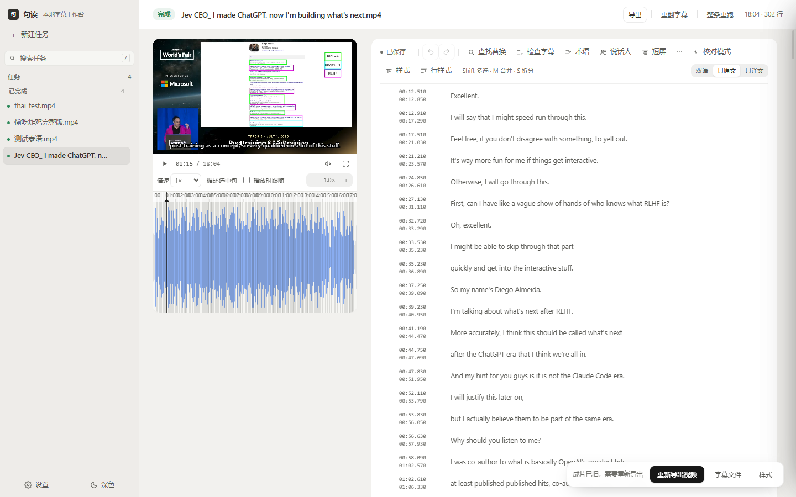
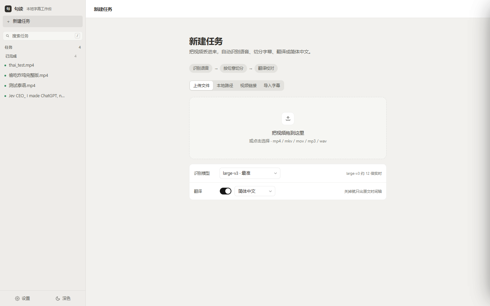
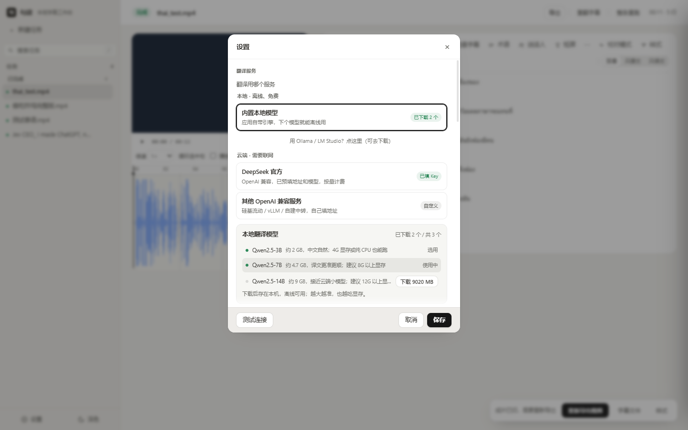
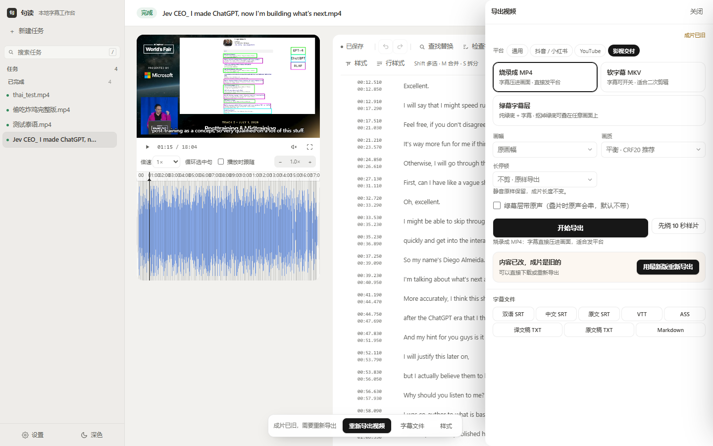

<div align="center">

# 句读 · 本地字幕工作台

**视频进去，成片出来 —— 识别、切分、翻译、校对、导出，一台电脑全搞定**

[简体中文](README.md) · [English](README.en.md)

[](https://github.com/justtio/judou-releases/releases/latest)
[](https://github.com/justtio/judou-releases/releases)
[](#%E7%B3%BB%E7%BB%9F%E8%A6%81%E6%B1%82)
[](#%E4%B8%BA%E4%BB%80%E4%B9%88%E7%94%A8%E5%AE%83)

[下载](#%E4%B8%8B%E8%BD%BD) · [功能](#%E5%8A%9F%E8%83%BD) · [常见问题](#%E5%B8%B8%E8%A7%81%E9%97%AE%E9%A2%98) · [更新日志](CHANGELOG.md)

</div>



---

## 为什么用它

市面上字幕工具不少，这个专注于三件事：

| | |
|---|---|
| **不用上传视频** | 识别和翻译都能在本机跑。访谈、内部会议、未公开素材，一个字都不出你的电脑。 |
| **不是"自动生成"就完事** | 生成之后还有一整条校对链：检查面板、波形微调、逐行样式、行内强调、术语统一。 |
| **翻译能对上号** | 逐行对应是硬约束。小模型漏行会自动兜底重翻，不是留一行空白让你自己发现。 |

## 功能

### 识别

- faster-whisper：`large-v3` / `large-v3-turbo` / `medium` / `small`
- NVIDIA 显卡走 CUDA，**没有独显也能用 CPU 跑**
- 也能直接导入已有字幕（SRT / VTT / ASS），只走翻译和校对



### 切分与时间轴

- 按**句意**切分，不是按固定字数硬切
- 波形图：缩放、拖动改时间、ripple 联动
- **拖动时间轴不会把播放头带走** —— 改时间的手势和移动播放头的手势分开
- 逐行微调、批量平移、快捷键（`M` 合并、`S` 拆分、`Shift` 多选）

### 翻译

- **云端**：DeepSeek 官方，或任意 OpenAI 兼容服务（硅基流动、vLLM、OneAPI…）
- **本地**：内置 llama.cpp + Qwen2.5（3B / 7B / 14B），点一下下载，之后完全离线免费
- 术语表 + 二遍校对，专有名词前后一致
- 目标语言：简体中文 · 繁體中文 · English · 日本語 · 한국어 · 泰语



### 校对

- 检查面板把问题分成两级：
  - **结构错误**（空行、缺译文、时间倒挂、时间重叠）——必须处理
  - **提示**（语速偏快、单行过长、重复、标点）——建议处理
- 你手动改过的行**自动不再提示**，不会被同一个问题反复打扰
- 行样式逐行可调：位置（自由拖动）、字号、颜色、粗细
- 行内强调：选中几个字单独换色

### 导出

- **烧录 MP4**：字幕压进画面，直接发平台
- **软字幕 MKV**：字幕可开关，适合二次剪辑
- **绿幕字幕层**：纯绿底 + 字幕，任意叠加
- 预设：通用 · 抖音/小红书 · YouTube · 影视交付
- 字幕文件：双语 SRT、中文 SRT、原文 SRT、VTT、ASS、纯文本



---

## 下载

**[⬇ 下载最新版](https://github.com/justtio/judou-releases/releases/latest)**

安装包约 1 GB（含 Python 运行时、ffmpeg、CUDA 库），识别模型首次使用时单独下载。

> **Windows 提示"已保护你的电脑"？**
> 安装包没有购买数字签名证书（一年几千美元）。点 **更多信息 → 仍要运行** 即可，不影响功能。

### 三步上手

1. 安装后打开，首次会让你选识别模型（不确定就选 `large-v3-turbo`，速度和准确度平衡）
2. 把视频拖进「新建任务」，等它跑完
3. 在编辑器里校对，点右上角「导出」

### 系统要求

| 项目 | 要求 |
|---|---|
| 系统 | Windows 10 / 11 64 位 |
| 显卡 | 可选。NVIDIA 显卡走 CUDA 快 3–5 倍；没有也能 CPU 跑 |
| 磁盘 | 安装约 2.3 GB；模型另算（small ≈ 0.5 GB，large-v3 ≈ 3 GB） |
| 内存 | 建议 16 GB |
| 网络 | 只有下载模型和用云端翻译时需要 |

### 更新

应用启动约 12 秒后自动检查新版本，弹窗询问后**差分下载**——只下变化的部分，通常 1–3 MB，几十秒完成。装好下次启动生效。

也可以手动到 [Releases](https://github.com/justtio/judou-releases/releases) 下载新版**覆盖安装**，任务和设置都会保留。

---

## 常见问题

<details>
<summary><b>翻译服务该选哪个？</b></summary>

- 有网、在意质量 → **DeepSeek 官方**（填 API Key，按量计费，很便宜）
- 要离线、不想花钱 → **内置本地模型**（下载 3B 约 2 GB 或 7B 约 4.7 GB）
- **Ollama / LM Studio** 是另外两个软件，你已经在用才需要选；没装的话卡片会直接带你去下载

不确定就先点「测试连接」——它真的会翻 3 行并检查行数对不对。
</details>

<details>
<summary><b>本地模型会漏行吗？</b></summary>

小模型偶尔会（JSON 模式下少返回一行）。应用里有兜底：检测到缺行就用纯文本单行重翻补齐。
如果整段译文明显错位，换个指令跟随更好的模型比调参数有效。
</details>

<details>
<summary><b>第一次识别为什么很慢？</b></summary>

首次使用要下载识别模型（`large-v3` 约 3 GB），下完之后启动只要几秒加载。
</details>

<details>
<summary><b>能批量处理多个视频吗？</b></summary>

可以，任务按队列依次处理，不会互相抢显存。
</details>

<details>
<summary><b>数据存在哪？卸载会丢吗？</b></summary>

任务、设置、模型都在本机：

```
%LOCALAPPDATA%\字幕工作台\
```

卸载不会删除这个目录，重装后任务还在。
</details>

<details>
<summary><b>支持 Mac / Linux 吗？</b></summary>

目前只做 Windows。核心是 Python + Electron，理论上可移植，但还没排期。
</details>

---

## 反馈

- 遇到问题或有建议 → [Issues](https://github.com/justtio/judou-releases/issues)
- 想要新功能 → 同上，说清使用场景即可

反馈时附上这两样能快很多：**版本号**（设置页底部）、**后端日志**（`%LOCALAPPDATA%\字幕工作台\backend.log`）。

---

## 关于本仓库

这个仓库**只存放安装包和说明文档**，不包含源代码。
安装包在 [Releases](https://github.com/justtio/judou-releases/releases) 的附件里，不在 git 历史中。
